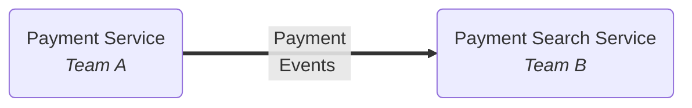
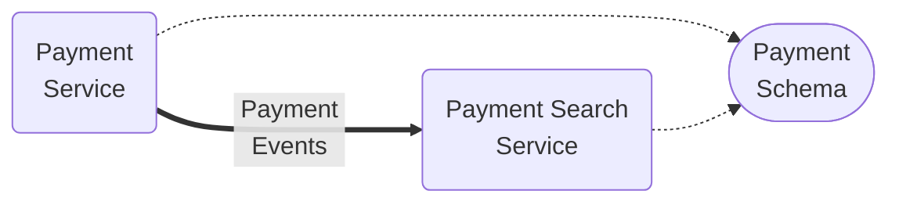
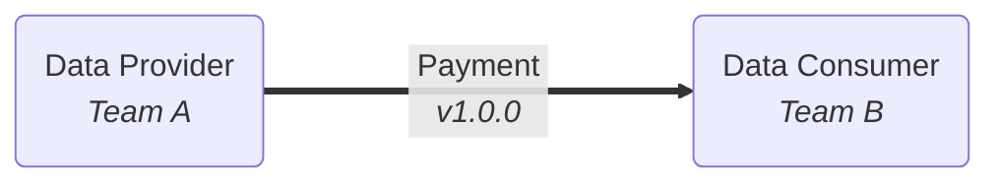
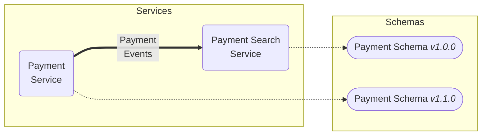

# Decoupled services, data evolution, and semantic versioning

Imagine the following scenario.

1. There are two teams. Team A owns a **Payment Service**, which records payments, and Team B owns a **Payment Search Service**, which can be used to look up payments quickly.
2. Payment Events flow from the Payment Service to the Payment Search Service, so the latter can keep its index up-to-date.

Let's imagine that both teams agree to use a schema called `payment.schema.json` to check that payment data they are sending or receiving is valid.

## 'Non Breaking' Changes can break things

Later, Team A need to add a new value, `refunded`, to the payment's `status` enum, to support a new feature. It looks harmless, so they change the schema in place, then deploy the schema and the Payment Service.

Team B's service has not changed: it still validates events against the schema as it was. The first refunded payment arrives, and the Payment Search Service rejects it, because `refunded` is not a status it knows.

Changing the shared schema in place broke a service whose team did nothing at all.

## 'Breaking' changes require coordination

1. Team A calls Team B and says "We need to change the Payment schema."
2. Team B are annoyed. They have their own priorities, but they agree to work together on changing their services
3. They both attempt to deploy their changes to production at the same time, but that is almost impossible in practice, and there is a period where things are broken, and the teams have to work together to patch issues that result.

**This is just for two teams.** Imagine the pain if there were 10 services and 10 teams all relying on each other's schemas!

## The right way, using semantic versioning

[Semantic versioning](https://semver.org/) is a way of versioning software that allows you to identify nature of changes between versions. It is a three-part version number `<major>.<minor>.<patch>`, e.g. `1.2.3`.

For data, it is useful to imagine a data provider and a data consumer - like the Payment Service and Payment Search Service in our example. The data provider is the service that creates the data, and the data consumer is the service that consumes the data.

- `major` - A breaking change - i.e. when the changed data is received by a consumer, it will break it.
- `minor` - A feature change in the data which will not break a consumer still on an earlier version, such as a new optional property.
- `patch` - A fix to the schema which will not break a consumer, such as a better description.

Providers move first: a provider starts sending a new version while its consumers still validate against an earlier one, and the consumers catch up in their own time. So a minor or patch version must only send data which every earlier version with the same major version accepts. A consumer should also ignore properties it does not know, so that providers can add them.

If a JSON schema includes a semantic version, then we can use it to identify situations when we can safely deploy data providers in isolation, and when we need to provide support for multiple data streams simultaneously to allow consumers to migrate at their own pace.

> [!TIP]
>
> JSM explicitly checks whether a supposedly 'non-breaking' change will actually break consumers when deployed, long before implementation begins.

Imagine the original schema is `payment_1_0_0.schema.json`.

So now, the process is as follows:

1. Team A create a new version of the payment schema, `payment_1_1_0.schema.json`. They think it should be a non-breaking feature change, so they increment the minor version number.
2. They use `jsm validate all` to check that the change is not breaking. As well as each version's own tests, it checks that each version's passing test documents are accepted by every earlier version with the same major version. Had they added the `refunded` status with a passing document using it, this check would fail, telling them it needs a new major version. Had they added it without such a document, JSM would warn that no passing document uses the new value.
3. The tests pass, and they deploy the new version of the schema.
4. Team A now deploys the new version of the Payment Service, which uses the new schema.
5. Team B's service is unaffected. It is still using the old schema, and that schema validates the new version of the data without a problem, as validated by JSM earlier.
6. Team B can now choose to upgrade to the new schema at their own pace.

## When a change is breaking

If a change would break consumers on the earlier version, such as the new `refunded` status, make it a new **major** version, `payment_2_0_0.schema.json`. The provider sends both versions side by side, for example on two topics, while each consumer moves to the new one during a deprecation window. Then the provider stops sending the old version.

A consumer can list the versions it uses in a `jsm-consumer.yml` file, and run `jsm check-consumer` in its pipeline, to learn when a newer major version appears. See [Avoiding breaking changes](./avoiding-breaking-changes.md) for changes which look safe, but are not.
